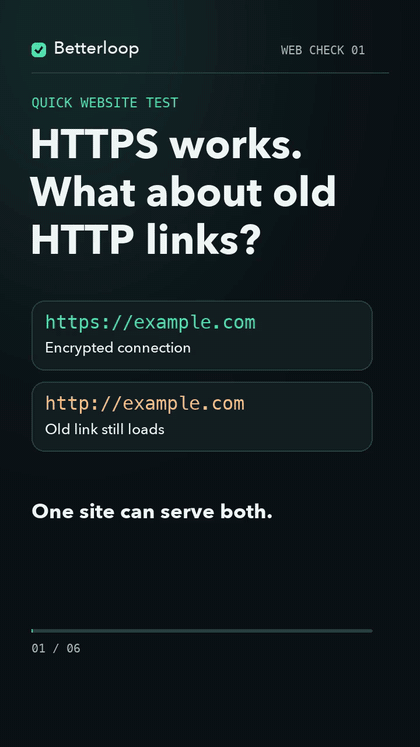
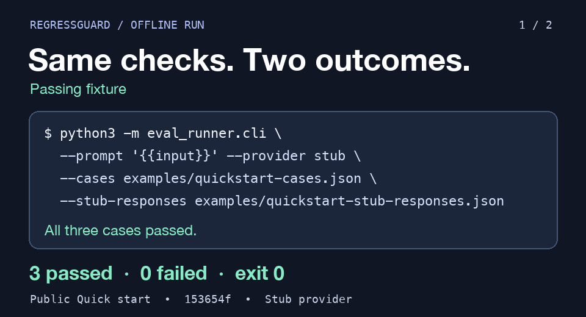

### Hi, I'm Nir

Full-stack and AI engineer. I build open-source tools that make coding agents (Claude Code, Codex,
Cursor) finish what they start, remember what they learn and spend less. More at
[nirfeinste.in](https://nirfeinste.in).

#### Two things I built and tested

**When 150 ms got marked High.** A Betterloop reader ran a check on a fast page and showed me an estimated 150 ms speed improvement ranked High. I changed the ranking and the saved case now comes back Low. [What I changed](https://www.reddit.com/r/SideProject/comments/1xnka9a/comment/19sa3vu65ey2p/) · [Run a free check on your site](https://betterloopai.com/check?utm_source=github&utm_medium=profile&utm_campaign=founder-proof).

**HTTPS works. What about old HTTP links?** Betterloop found an old HTTP address that still loads on the demo site. [Check your own site for free](https://betterloopai.com/check?utm_source=github&utm_medium=video&utm_campaign=https-redirect-short).

Watch the 30-second HTTPS lesson

[Download the MP4](https://github.com/fainir/fainir/blob/main/assets/betterloop-https-redirect.mp4).

**The same prompt checks, two different results.** I ran the bundled RegressGuard cases twice. The first set of responses passed all three. The second set failed two, including `OK.` where the case expected `ok`. [Run both offline examples](https://github.com/fainir/regressguard?utm_source=github&utm_medium=profile&utm_campaign=founder-proof#quick-start).

Watch the RegressGuard terminal demo

#### Products

Choose a job, then try the tool. Free and paid parts are described beside each link.

| Product | Start here |
|---------|------------|
| [Betterloop](https://betterloopai.com/check?utm_source=github&utm_medium=profile&utm_campaign=betterloop) | Paste a website URL for a free check, with no signup. Ongoing monitoring has [Free and Pro plans](https://betterloopai.com/pricing?utm_source=github&utm_medium=profile&utm_campaign=betterloop). |
| [Plainer](https://plainer.app/demo?example=starter&utm_source=github&utm_medium=profile&utm_campaign=plainer) | Explore a workspace for notes, files and planning. Notes and planning are free; the signed-in assistant has an [optional Pro allowance](https://plainer.app/pricing?utm_source=github&utm_medium=profile&utm_campaign=plainer). |
| [Modurobot](https://modurobot.com/?utm_source=github&utm_medium=profile&utm_campaign=modurobot) | Try a robot in a free 3D simulation, then compare parts and see the [current Seeed offer in the SO-101 buying worksheet](https://modurobot.com/so101.html?utm_source=github&utm_medium=profile&utm_campaign=modurobot-offer#seeed-so101-offer). Parts links may earn me an affiliate commission. |
| [KeepFinding](https://keepfind.ing/?utm_source=github&utm_medium=profile&utm_campaign=keepfinding) | Save a link or import bookmarks into a free read-later library. Try it in this browser; sign in to sync across devices. |
| [MyFeed](https://myfeed.space/?utm_source=github&utm_medium=profile&utm_campaign=myfeed) | Read a free topic feed or create one about something you care about. Optional email digests. |
| [Gramfix](https://gramfix.app/?utm_source=github&utm_medium=profile&utm_campaign=gramfix) | Correct selected text in compatible Mac apps with a shortcut. Apple Silicon; limited included corrections or your own OpenAI key. |
| [WebSkins](https://chromewebstore.google.com/detail/webskins/fdjggaobnbpmajhobbcedeonbgmolala?utm_source=github&utm_medium=profile&utm_campaign=webskins) | Give websites a different look with an AI-powered Chrome extension. The public Store version requires your own Anthropic key. |
| [AI Your Work](https://aiyourwork.chat/?utm_source=github&utm_medium=profile&utm_campaign=aiyourwork) | Start a free guided assessment of useful automations for your business, on the website or [Telegram](https://t.me/AIYourWorkBot). |
| [Human in da Loop](https://www.humanindaloopai.com/self-host.html?utm_source=github&utm_medium=profile&utm_campaign=humanindaloop) | Let an AI agent ask your team for help. Start with the free software's setup guide; hosting and provider costs are your own. Paid worker jobs are not live. |
| [OpenWorld](https://open-world.gg/?utm_source=github&utm_medium=profile&utm_campaign=openworld) | Play a free 3D browser game and change it with words. AI edits use limited included credit when available, or your own provider-billed key. ([Source](https://github.com/fainir/open-world)) |
| [VidGen Studio](https://vidgen.studio/?utm_source=github&utm_medium=profile&utm_campaign=vidgen) | Turn a story into a free 3D storyboard, then film scenes with AI. Generated video, images and narration use prepaid credit. |

#### Concept demos

These are concepts to explore, not products available to order.

| Concept | Explore |
|---------|---------|
| [Small Living](https://smallliv.ing/?utm_source=github&utm_medium=profile&utm_campaign=smallliving) | A modular electric-camper concept in 3D. |
| [Nested Blocks](https://nestedblocks.shop/?utm_source=github&utm_medium=profile&utm_campaign=nestedblocks) | A modular-furniture concept that starts with a conversation. |

#### Visual learning

[Hired in 60](https://www.youtube.com/playlist?list=PLf8lBoNiNd2g&utm_source=github&utm_medium=profile&utm_campaign=hiredin60): start with six short, visual developer interview-prep lessons, then explore the [YouTube channel](https://www.youtube.com/channel/UCr7apjzj6Pubx-X7ManU52g). Also on [Instagram](https://www.instagram.com/hiredin60/?utm_source=github&utm_medium=profile&utm_campaign=hiredin60) and [TikTok](https://www.tiktok.com/@hiredin60); those platforms may ask you to sign in.

#### Open source

| Project | What it does | |
|---------|--------------|---|
| [most-capable-agent-system-prompt](https://github.com/fainir/most-capable-agent-system-prompt) | A copy-paste system prompt that has your coding agent build a self-improving agent system for any computer work |  |
| [agent-harness](https://github.com/fainir/agent-harness) | Skills, rules and hooks that make Claude Code or Codex act as a product team, a CEO or a portfolio manager |  |
| [frugal](https://github.com/fainir/frugal) | Your agent finds free tiers, programs, verified promo codes and cheaper alternatives before it pays for anything |  |
| [flipback](https://github.com/fainir/flipback) | An automatic `/goal` for every turn: sends Claude Code back when it stops before the work is done |  |
| [recall](https://github.com/fainir/recall) | Your Claude Code memory in every agent: Codex, Cursor and others read and write it over MCP |  |
| [conductor](https://github.com/fainir/conductor) | Verified, retried and fallback-backed commands for Claude Code, served as MCP tools |  |
| [account-access](https://github.com/fainir/account-access) | Scoped, resumable account access for coding agents, with OAuth renewal |  |
| [mac-keepawake](https://github.com/fainir/mac-keepawake) | Keep your Mac awake with the lid closed, and dim the backlight while it's shut |  |
| [handy-ai](https://github.com/fainir/handy-ai) | Android assistant that completes tasks on your phone: it taps, types and follows through |  |
| [regressguard](https://github.com/fainir/regressguard) | Self-hosted CI eval harness for prompt regression testing (Docker + CLI) |  |
| [standup](https://github.com/fainir/standup) | Writes your standup update from your git commits, in one command |  |

If one of these saves you time or money, a star helps other people find it.
